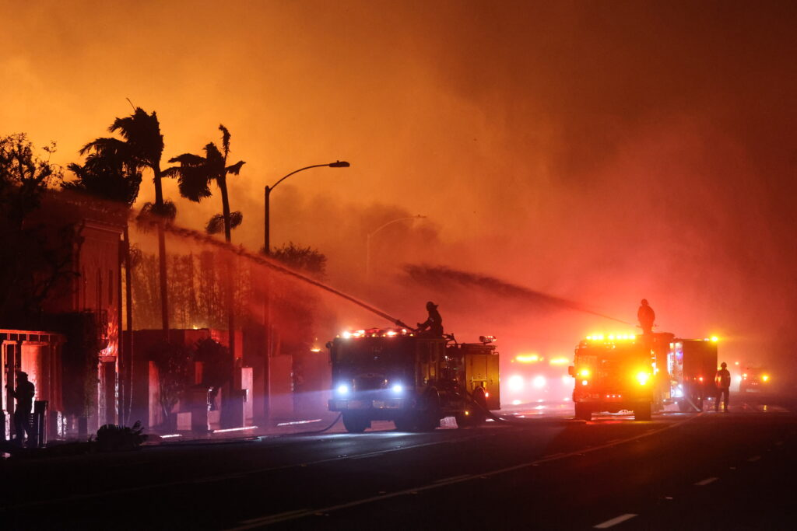

# Visualizing the January 2021 Eaton and Palisades Fires Through True and False Imagery



<p align="center">
  <a href="https://www.news.caloes.ca.gov/a-year-after-the-la-fires-pacific-palisades-and-altadena-communities-recover/">Source: Cal OES News</a>
</p>


## About

This repository is for Homework 4 for EDS 220: Working with Environmental Datasets. The analysis visualizes the Eaton and Palisades fires from January 2021 through both true and false imagery. To do so, it uses one Landsat dataset that was clipped to an area surrounding the fire perimeters and two other datasets containing the fire perimeters.


## Highlights of the Analysis

* Exploring Landsat 8 satellite imagery and wildfire perimeter vector data
* Exploring and wrangling raster data stored in a netCDF file using `xarray` and `rioxarray`
* Restoring CRS information to enable geospatial analysis
* Creating and customizing true and false color image maps
* Combining and mapping raster and vector data to visualize fire scars


## Data

**Fire Perimeter**

The data was retrieved from the [County of Los Angeles Enterprise GIS](https://egis-lacounty.hub.arcgis.com/maps/ad51845ea5fb4eb483bc2a7c38b2370c/about), which was pulled from CAL FIRE's Historical Fire Perimeter Dataset. It was downloaded as two separate shapefiles, one for each fire.

**Landsat**

The data was retrieved from the [Microsoft Planetary Computer data catalog](https://planetarycomputer.microsoft.com/dataset/landsat-c2-l2) and clipped to an area surrounding the fire perimeters. This data should be used for visualization and educational purposes only, and was downloaded from the course's shared Google Drive.

Neither of the datasets are included in this repository. The fire perimeter data is accessible through the link in the References section, and the Landsat data can be accessed through the EDS 220 course shared Google Drive.

## Repository Structure
```
eds220-hwk4
├── LICENSE
├── README.md
├── hwk4-task2-false-color-SIENKO.ipynb # Jupyter notebook for the analysis
└── images
    ├── eaton_palisades_fire.png # Final false color image map
    └── la_fire.jpg # Image used in the README
```

## References

Los Angeles County. (2025). Palisades and Eaton dissolved fire perimeters (2025) [GIS dataset]. *Los Angeles County Enterprise GIS*. https://egis-lacounty.hub.arcgis.com/datasets/lacounty::palisades-and-eaton-dissolved-fire-perimeters-2025

Microsoft. (n.d.). Landsat Collection 2 Level-2. *Microsoft Planetary Computer*. https://planetarycomputer.microsoft.com/dataset/landsat-c2-l2

Galaz García, C. (2025). EDS 220: Working with Environmental Datasets [Course website]. Master of Environmental Data Science, Bren School of Environmental Science & Management, University of California, Santa Barbara. https://meds-eds-220.github.io/MEDS-eds-220-course/